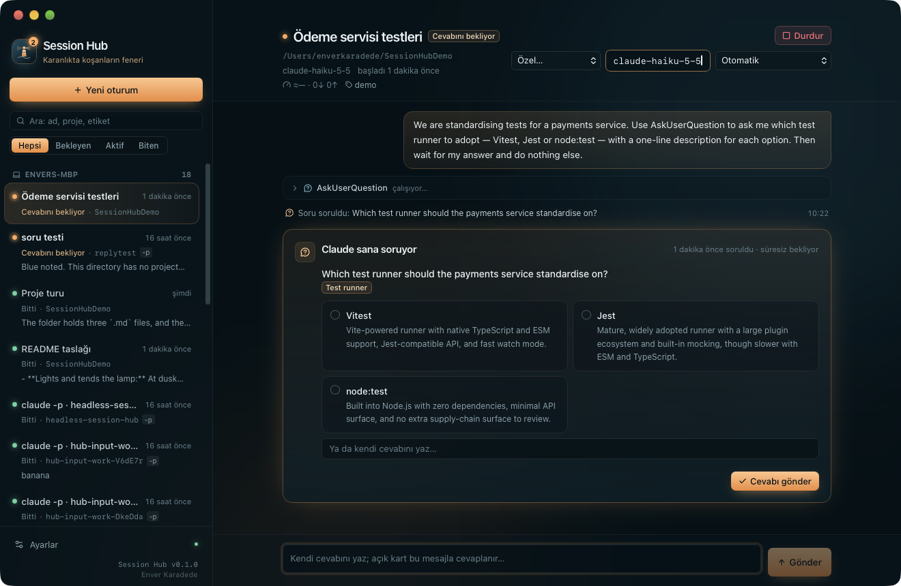
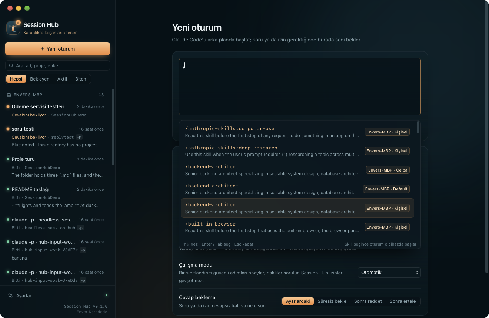
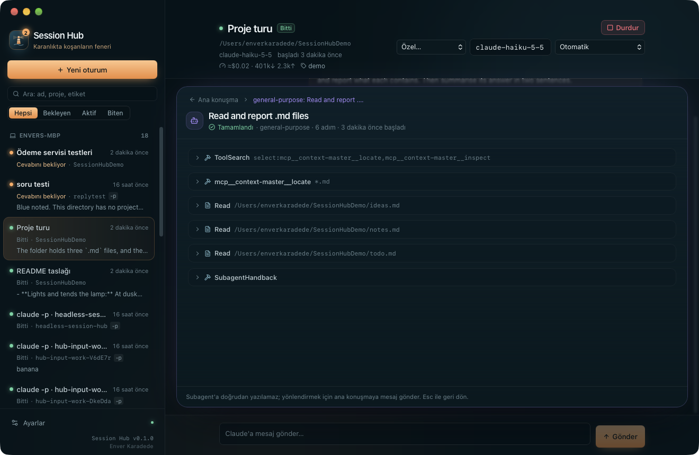
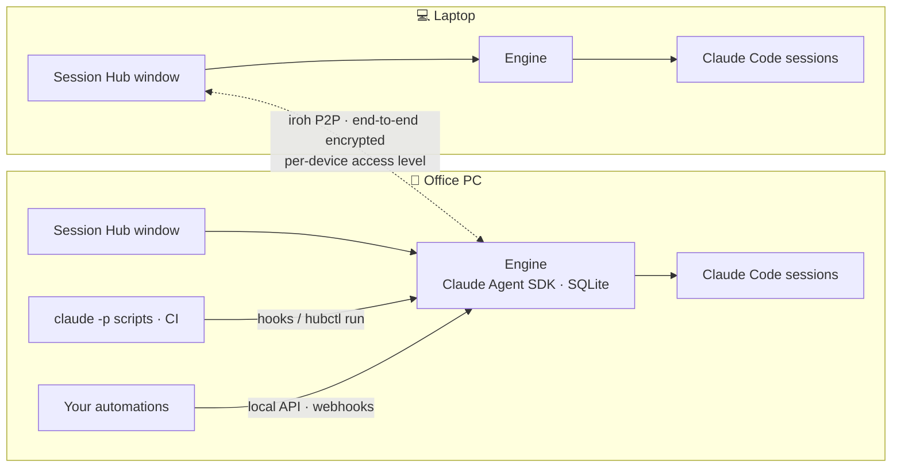

<p align="center">
  
</p>

<p align="center">
  <a href="https://github.com/enverkaradede/headless-session-hub/releases/latest"></a>
  
  
  
  
</p>

<p align="center">
  <b>Run Claude Code in the background. Answer its questions when it needs you.</b><br>
  <sub>A desktop app for macOS and Windows that runs, watches and talks to headless Claude Code sessions,<br>on this machine and on the other machines you own.</sub>
</p>

<br>

<p align="center">
  
</p>

## Why

Headless Claude Code (`claude -p`, the Agent SDK, scheduled jobs, CI) has nobody to talk to. When the model
asks a question or a tool needs permission, the run either fails or decides on its own. You cannot see which
runs are working, which are stuck, and which have hit a usage limit.

**Session Hub is the lighthouse keeper.** It runs those sessions for you and keeps watch. The moment one
needs you, it lights up: a card for the question, a card for the permission, a notification on your desktop.
You answer, and the run carries on.

## Highlights

<table>
  <tr>
    <td width="50%" valign="top">
      <h4>💬 Sessions as chats</h4>
      Start Claude Code in any allowed folder and follow it live: messages, tool calls, results and cost.
      Message it, stop it, change the model or the working mode while it runs, or resume a finished run
      days later with its whole history.
    </td>
    <td width="50%" valign="top">
      <h4>🙋 Questions and permissions, answered</h4>
      <code>AskUserQuestion</code> arrives as a card with options, multi-select or your own words. Permission
      requests show the command and let you allow once, allow for the session, or deny with a reason. If you
      are away, the session can pause and pick up again when you answer.
    </td>
  </tr>
  <tr>
    <td valign="top">
      <h4>⌨️ The message box never locks</h4>
      Type while a card is open and your message answers it. Type while an external <code>claude -p</code> is
      still running and your message waits in a queue, then continues the session as soon as that process ends.
    </td>
    <td valign="top">
      <h4>✨ <code>/</code> commands and skills from every device</h4>
      Type <code>/</code> to see Claude's commands and the skills of this machine and your paired machines.
      Each row shows where the skill lives. Pick one, and the session starts on that machine with that profile.
    </td>
  </tr>
  <tr>
    <td valign="top">
      <h4>🤖 Subagents in their own pane</h4>
      Each subagent becomes a live card with its current step. Open it to read its full conversation in a
      separate pane, then jump back with Esc.
    </td>
    <td valign="top">
      <h4>🛰️ Your devices, peer to peer</h4>
      Pair your office PC with your laptop using a one-time code. No server, no account: devices connect
      directly over encrypted QUIC (iroh). Each paired device gets its own access level: read-only, operator
      or full.
    </td>
  </tr>
  <tr>
    <td valign="top">
      <h4>🔌 Works with the scripts you already have</h4>
      Install the hooks once, or put <code>hubctl run</code> in front of <code>claude</code>. Existing
      <code>claude -p</code> jobs then appear in the list, their permission prompts come to the app, and
      plain-text questions are detected and can be answered.
    </td>
    <td valign="top">
      <h4>🛡️ Your subscription stays your subscription</h4>
      Sessions run on each machine's own Claude login. Session Hub never switches to an API key on its own,
      stops at usage limits and waits for your decision, and masks secrets before anything leaves a device.
    </td>
  </tr>
</table>

<p align="center">
  
  &nbsp;
  
</p>
<p align="center"><sub>Left: the <code>/</code> menu, each skill labelled with its device and profile. Right: a subagent's own conversation.</sub></p>

## Download

| Platform | File | Notes |
|---|---|---|
| **macOS** (Apple Silicon) | [`Session.Hub_<version>_aarch64.dmg`](https://github.com/enverkaradede/headless-session-hub/releases/latest) | Not signed with an Apple Developer ID yet: the first time, right-click the app → **Open**. |
| **Windows** (x64, also runs on ARM) | [`Session.Hub_<version>_x64-setup.exe`](https://github.com/enverkaradede/headless-session-hub/releases/latest) | Installs per user, no admin rights. SmartScreen may ask: **More info → Run anyway**. |

**You also need** [Claude Code](https://code.claude.com/docs) installed and logged in on each machine.
Node.js comes bundled with the app.

Updates are signed and installed from inside the app (**Ayarlar → Hakkında**). The interface is in Turkish; menu names below are given as they appear.

## Getting started

1. **Profiles.** **Ayarlar → Genel** lists your Claude logins. Each profile is a `CLAUDE_CONFIG_DIR`, so a
   personal and a work account can live side by side.
2. **Allowed folders.** Sessions only start inside folders you allow. Add your projects under
   **Ayarlar → Genel**.
3. **Start a session.** Click **Yeni oturum**, describe the task, pick the folder and press ⌘/Ctrl + Enter.
4. **Optional: bring your scripts.** **Ayarlar → Entegrasyonlar** installs the hooks for a profile, or use
   `hubctl run` (below).
5. **Optional: pair a device.** **Ayarlar → Cihazlar**: turn on remote access on the host, choose an access
   level, create a code, and paste it on the other machine.

### Working modes

| Mode | What happens | Default |
|---|---|:-:|
| **Otomatik** (auto) | A classifier approves safe steps; risky ones come to you as cards | ✅ |
| **Sor** (default) | Every step that needs permission is asked | |
| **Düzenlemeleri kabul et** (acceptEdits) | File edits go through; commands are still asked | |
| **Plan** | Plans only; nothing runs | |
| **Sorma** (dontAsk) | Anything not pre-allowed is denied; no cards at all | |

Change the default under **Ayarlar → Davranış**, per session when starting it, or live from the session header.

## How it works



- **One app, no server.** Every install supervises the sessions on its own machine. Pairing only lets one
  window also show another machine's sessions, within the access level that machine granted.
- **Engine.** A Node sidecar drives Claude Code through the Agent SDK: `canUseTool` for permissions, a
  `PreToolUse` hook for `AskUserQuestion` (so a long wait can close the process and resume later), and
  SQLite for sessions, timelines, requests and the audit log.
- **Shell.** Tauri v2 (Rust): the window, tray, notifications, auto-update and the P2P link.

## For scripts and automations

```bash
# Run an existing claude -p job through the hub: it shows up, asks you, and reports cost
hubctl run --name nightly --label ci -- -p "Run the test suite and fix what breaks" --output-format json

hubctl sessions --status waiting_input,waiting_permission   # what needs you
hubctl requests 3f2a                                        # what exactly is being asked
hubctl answer 3f2a 9c1d --answer 2                          # pick option 2
hubctl reply 3f2a "use the staging config"                  # answer a plain-text question
```

The engine also listens on `127.0.0.1` with a bearer token for a local REST API, and sends signed
(HMAC-SHA256) webhooks such as `session.waiting`, `session.completed` and `session.usage_limit`.
See [docs/api.md](docs/api.md).

## Security at a glance

- **No credentials are stored or carried.** Claude Code logs in on each machine by itself. API-key and
  provider variables are stripped from sessions unless you explicitly allow them.
- **Allowed folders only.** This applies to new sessions, resumed sessions and requests from paired devices.
- **Per-device access.** Read-only devices cannot answer or start anything. Every answer is written to the
  audit log with who, when and what.
- **Masking at the edge.** Tokens, passwords and keys are masked before events leave the device.
  "Summary only" mode hides commands and file contents from paired devices completely.
- **Local API.** Loopback only, token required, and any request from a browser is refused.

Details: [docs/security-model.md](docs/security-model.md).

## Development

```bash
pnpm install
pnpm dev                    # builds the engine + hubctl, then `tauri dev`
pnpm test                   # engine and UI (vitest) + hubctl (cargo test)
pnpm typecheck && pnpm lint:rust
pnpm smoke -- ~/.claude     # end-to-end against the real CLI (a few cents of Haiku)
```

Requirements: Node 24+, pnpm 11, Rust stable, Claude Code installed and logged in.
Release builds: [docs/releasing.md](docs/releasing.md). Windows setup: [docs/setup.md](docs/setup.md).

| Path | What |
|---|---|
| `apps/desktop` | Tauri shell (Rust) and React + Tailwind UI |
| `packages/engine` | Node engine: Agent SDK sessions, permissions, SQLite, local API, hooks, webhooks, masking |
| `packages/protocol` | Shared zod contract between engine, UI and paired devices |
| `crates/hubctl` | CLI: hook bridge, `claude -p` wrapper, inbox |
| `docs/` | [API](docs/api.md) · [security model](docs/security-model.md) · [setup](docs/setup.md) · [releasing](docs/releasing.md) · [findings](docs/findings.md) · [E2E scenarios](docs/e2e-scenarios.md) · [changelog](CHANGELOG.md) |

<br>

<p align="center">
  
  <br>
  <sub>Made by <b>Enver Karadede</b></sub>
</p>
